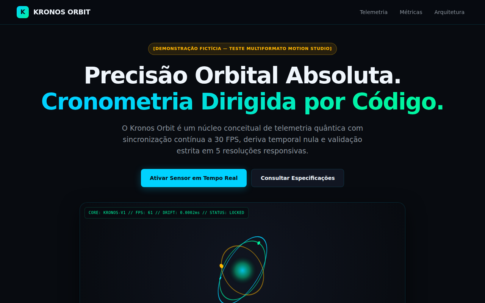
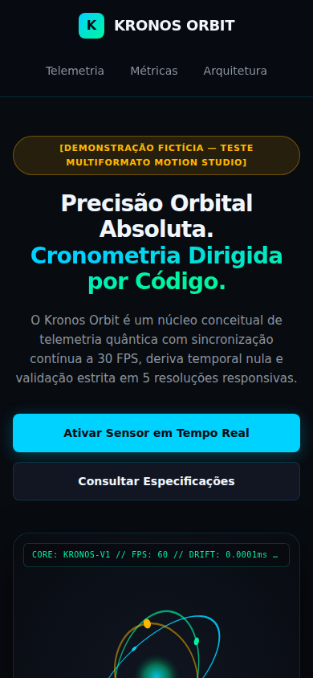
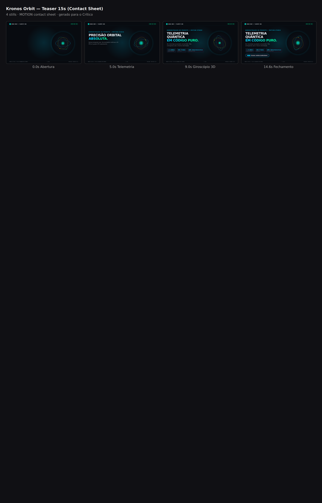
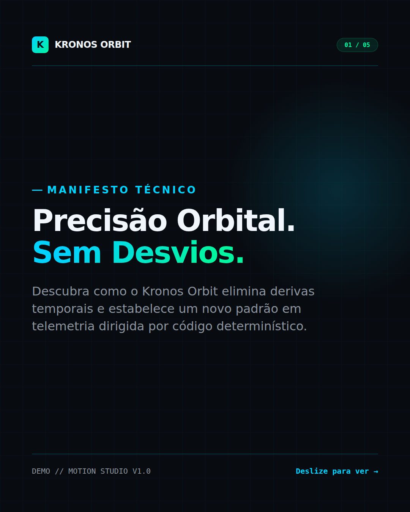

<div align="center">

# 🎬 MOTION Studio

> **An agent-powered creative development framework for cinematic websites, 3D experiences, motion graphics, videos, and social content.**

[](LICENSE)
[](https://nodejs.org/)
[](https://playwright.dev/)
[](docs/PRODUCTION_GUIDE.md)

*50 Agent Skills · Claude Code · Google Antigravity · OpenCode · Playwright Multi-Viewport QA · Deterministic CFR Render Engine*

</div>

---

## 📑 Table of Contents / Índice

1. [What is MOTION / O que é o MOTION](#-what-is-motion--o-que-é-o-motion)
2. [Real Demonstrations / Demonstrações Reais](#-real-demonstrations--demonstrações-reais)
3. [Current Capabilities / Capacidades Atuais](#-current-capabilities--capacidades-atuais)
4. [System Requirements / Requisitos](#-system-requirements--requisitos)
5. [Quick Start / Início Rápido](#-quick-start--início-rápido)
6. [CLI Commands / Comandos da CLI](#-cli-commands--comandos-da-cli)
7. [Skill Distribution & Selective Profiles / Perfis de Skills](#-skill-distribution--selective-profiles--perfis-de-skills)
8. [Agent Compatibility / Compatibilidade com Agentes](#-agent-compatibility--compatibilidade-com-agentes)
9. [Architecture / Arquitetura](#-architecture--arquitetura)
10. [Production Examples / Exemplos de Produção](#-production-examples--exemplos-de-produção)
11. [Limitations / Limitações Técnicas](#-limitations--limitações-técnicas)
12. [Licenses & Provenance / Licenciamento](#-licenses--provenance--licenciamento)
13. [Contributing / Contribuição](#-contributing--contribuição)

---

## 🌟 What is MOTION / O que é o MOTION

**MOTION Studio** transforms AI coding agents into an end-to-end creative studio. Instead of prompting separate disconnected tools or generating brittle throwaway assets, MOTION brings an industrial, deterministic, code-driven creative pipeline directly into your projects.

O **MOTION** é um framework de desenvolvimento criativo orientado a agentes de IA para produção de **websites cinematográficos, experiências 3D interativas, motion design, vídeos promocionais e conteúdo social de alta fidelidade**.

Cada entrega é construída em **código real** (React, Next.js, HTML5/CSS3, Remotion, Three.js, Canvas), determinística, auditada por QA multi-viewport automatizado e empacotada com manifestos criptográficos SHA-256 para distribuição profissional.

---

## 🖼️ Real Demonstrations / Demonstrações Reais

Todas as demonstrações abaixo foram produzidas de ponta a ponta pela infraestrutura do MOTION Studio para a campanha multi-formato **Kronos Orbit**:

### 1. Cinematic Responsive Website (Next.js + R3F Hero)
Auditado e aprovado com 100% PASS em 5 viewports distintas (Mobile-S 360px, Mobile 390px, Tablet 768px, Desktop 1280px e Wide 1920px):

| Desktop Hero (1280×800) | Mobile Viewport (390×844) |
|---|---|
|  |  |

### 2. Deterministic CFR Video (15s @ 30 FPS — 450 Frames)
Renderização determinística bit-a-bit quadro a quadro, montagem CFR FFmpeg YUV420p e folha de contato (contact sheet) para inspeção do crítico:

<div align="center">
  
  <p><em>Contact Sheet de Produção — 450 quadros inspecionados com determinismo visual absoluto.</em></p>
</div>

### 3. High-Res Social Carousel (5 Slides 1080×1350 & 2160×2700)
Carrossel editorial com roteiro, tipografia calibrada, legendas e pacote ZIP de entrega com manifesto SHA-256:

<div align="center">
  
  <p><em>Slide 01 — Render nativo em alta resolução (Chromium 2x device scale).</em></p>
</div>

---

## ⚡ Current Capabilities / Capacidades Atuais

- **🌐 Web Experiences (`web-director`)**: Landing pages em Next.js / Vite, heros 3D interativos com `@react-three/fiber`, tipografia responsiva, micro-interações, acessibilidade WCAG AA (alvos de toque >=44px) e auditoria visual em 5 viewports via Playwright.
- **🎥 Vídeo Cinematográfico (`motion-director`)**: Pipeline determinístico de 5 departamentos (Brief → Estilo → Storyboard → Animação por frame → Render CFR 30fps → Crítico independente → Reparo). Sem drops de FPS, montagem MP4 universal (H.264 / AAC / YUV420p).
- **📱 Shorts Narrados (`shorts-director`)**: Vídeos verticais 9:16 com sincronia por frame, suporte a narração com timestamps e legendas animadas em beat.
- **🎠 Estúdio Social (`carousel-studio`, `story-studio`, `feed-studio`)**: Carrosséis de 5 a 10 slides, stories respeitando safe-zones de Instagram e WhatsApp, e posts em proporções 1:1, 4:5 e 16:9 sem distorção ou corte cego.
- **🧊 3D Procedural (`3d-scene-director`)**: Modelagem procedural Three.js, pipeline de assets GLB otimizados e integração de ferramentas externas (Blender opcional).
- **🔒 Isolamento de Marcas & Memória Visual**: Cada projeto consumidor possui seus próprios tokens (`tokens.json`), tom de voz (`PROFILE.md`) e galeria local isolada.

---

## 💻 System Requirements / Requisitos

O MOTION foi desenvolvido para operar de forma confiável em ambientes Linux e macOS (e Windows via WSL2):

| Componente | Obrigatório | Versão Mínima | Finalidade |
|---|---|---|---|
| **Node.js** | Sim | `>= 18.0.0` (recomendado 20+) | Execução da CLI, compilação de templates e scripts ESM |
| **Python 3** | Sim | `>= 3.10` | Validação dimensional, manifestos SHA-256 e contact sheets |
| **FFmpeg** | Sim | `>= 4.4` (com `libx264`) | Codificação determinística CFR 30fps, áudio e vídeo |
| **Chromium** | Sim | Playwright / Chrome nativo | Captura de frames, render estático 2x e QA multi-viewport |
| **Three.js** | Opcional | `r160+` | Renderização procedural 3D e exportação GLB |
| **Blender** | Opcional | `>= 3.6` | Especialista 3D para modelagem e renderização física |
| **Chatterbox TTS**| Opcional | Biblioteca Python | Síntese de voz neural (com fallback silencioso e legendas) |

---

## 🚀 Quick Start / Início Rápido

Instale o MOTION em qualquer projeto consumidor existente (Next.js, Vite, React, etc.) sem duplicar o monorepo:

### 1. Instalação via NPM

> [!NOTE]
> **Disponibilidade no NPM:** Os comandos `npm install -D motion-cli motion-core motion-studio-skills` estarão disponíveis no registro público oficial do npm após a publicação do release. Durante a fase de **Release Candidate (`1.0.0-rc.1`)**, a instalação é realizada via tarballs locais (`npm install -D ./dist/packages/*.tgz`) ou via repositório.

```bash
# Instalação padrão pós-publicação
npm install -D motion-cli motion-core motion-studio-skills
```

### 2. Inicialização do Estúdio
```bash
# Inicializa o estúdio com o perfil essencial 'core'
npx motion init --brand="MinhaMarca"

# Ou instale o perfil desejado: core, web, motion, social, 3d, blender, all
npx motion init --brand="MinhaMarca" --profile=web
```

### 3. Diagnóstico do Ambiente
```bash
# Valida se todas as dependências estão operacionais
npx motion doctor
```

### 4. Criação e Renderização
```bash
# Crie uma landing page responsiva
npx motion create website landing-produto

# Crie um carrossel de 5 slides
npx motion create carousel post-lancamento

# Renderize o carrossel em alta resolução
npx motion render carousel motion/projects/post-lancamento/slides motion/projects/post-lancamento/out

# Audite a landing page em 5 viewports
npx motion qa motion/projects/landing-produto/index.html motion/projects/landing-produto/qa

# Exporte o pacote final com manifesto SHA-256
npx motion export motion/projects/post-lancamento entrega-v1.zip
```

---

## 🛠️ CLI Commands / Comandos da CLI

A CLI `motion` é unificada, agnóstica de agente e executa operações reais no sistema:

```
Uso: motion <comando> [opções]

Comandos:
  init                     Inicializa o estúdio no projeto atual
    --brand=<nome>         Define o nome da marca (padrão: nome da pasta)
    --profile=<nome>       Perfil de skills: core, web, motion, social, 3d, blender, all
    --force                Sobrescreve configuração existente

  doctor                   Audita dependências obrigatórias e opcionais do sistema

  list | specs             Lista especialidades do estúdio e perfis de skills

  create <tipo> <nome>     Gera scaffold funcional de entregável
    Tipos:                 website, video, carousel, story, post

  preview [caminho]        Inicia servidor HTTP local de pré-visualização (padrão: porta 3300)

  render <modo> ...        Executa motores de renderização determinísticos
    render static <html_in> <png_out> [--width=W] [--height=H] [--scale=N]
    render frames <comp_in> <outdir> [--frames=N] [--fps=30]
    render video <frames_dir> <mp4_out> [--fps=30] [--audio=trilha.mp3]
    render carousel <slides_dir> <outdir>
    render project <pasta_do_projeto>

  export <pasta> <zip_out> Gera manifesto SHA-256 e empacota entrega final em ZIP
    --gallery              Registra na galeria local com status draft

  qa <url_ou_html> <outdir> Executa auditoria multi-viewport em 5 telas com Playwright
```

---

## 🎯 Skill Distribution & Selective Profiles / Perfis de Skills

Para evitar sobrecarregar projetos consumidores com 50 skills de uma só vez, o MOTION suporta **distribuição seletiva de perfis**:

| Perfil | Skills Instaladas | Foco |
|---|---|---|
| **`core`** *(padrão)* | `studio-director`, `motion-director`, `web-director`, `brand`, `design`, `design-system` | Diretores de estúdio e contratos de marca compartilhados. Ideal para projetos leves. |
| **`web`** | `core` + `ui-styling`, `ui-ux-pro-max`, `impeccable`, `animate`, `emil-design-eng`, `apple-design`, `prototype`, `revenue-centric-design` | Websites, landing pages e engenharia de design frontend. |
| **`motion`** | `core` + `shorts-director`, `video-shotcraft`, `brag`, `lemo-opuscar`, `media-use`, `hyperframes`, `remotion-*` (12 skills) | Vídeos promocionais, motion graphics e animações CFR. |
| **`social`** | `core` + `carousel-studio`, `story-studio`, `feed-studio`, `banner-design`, `slides` | Carrosséis de alta resolução, stories verticais e posts de feed. |
| **`3d`** | `core` + `3d-scene-director`, `anatomy`, `diagram-design` | Cenas 3D procedurais WebGL e diagramação isométrica. |
| **`blender`** | `3d` + instruções e automações para pipelines Blender. | Especialistas de renderização e modelagem externa. |
| **`all`** | Todas as 50 Agent Skills do ecossistema. | Instalação completa e irrestrita. |

Para selecionar o perfil na inicialização:
```bash
npx motion init --profile=social
```

---

## 🤖 Agent Compatibility / Compatibilidade com Agentes

O MOTION adota o padrão aberto [Agent Skills](https://skills.sh) com frontmatter YAML e instruções estruturadas em Markdown:

| Ambiente / Agente | Descoberta | Ativação | Execução de Ferramentas | Pipeline Completo | Status |
|---|:---:|:---:|:---:|:---:|---|
| **Google Antigravity** | ✅ Sim | ✅ Sim | ✅ Sim (`run_command`, tools) | ✅ Validado | **Suporte Nativo** |
| **Claude Code** | ✅ Sim (`.claude/skills`) | ✅ Sim | ✅ Sim (Bash tool) | ✅ Validado | **Suporte Nativo** |
| **OpenCode** | ✅ Sim (`.opencode/skills`) | ✅ Sim | ✅ Sim (Bash tool) | ✅ Validado | **Suporte Nativo** |
| **Cursor / Windsurf** | ✅ Sim | ⚠️ Manual | ⚠️ Depende do terminal | ⚠️ Parcial | **Compatível via CLI** |
| **GitHub Copilot** | ⚠️ Parcial | ⚠️ Manual | ❌ Não | ⚠️ Parcial | **Suporte a Prompts** |

---

## 🏛️ Architecture / Arquitetura

O ecossistema é modularizado em três pacotes distribuíveis independentes:

```
@motion-studio/
├── packages/motion-core           # Motores de render, QA Playwright, FFmpeg CFR, validadores
├── packages/motion-skills         # Catálogo de 50 skills e instalador de perfis
└── packages/motion-cli            # Binário 'motion', subcomandos e scaffolds funcionais
```

### O Pipeline de 5 Departamentos
```
Briefing (Linguagem Natural)
  └──► Diretor Geral (studio-director)
        ├──► web-director (Web / 3D)
        ├──► motion-director (Vídeo CFR)
        └──► carousel/story/feed-studio (Social)
              └──► Motores Core (Playwright / Chromium / FFmpeg)
                    └──► QA Multi-Viewport (5 telas)
                          └──► Crítico Independente (Review Frame-a-Frame)
                                └──► Pacote ZIP + Manifesto SHA-256 + Galeria Local
```

---

## 📦 Production Examples / Exemplos de Produção

Consulte as produções reais na pasta `projects/`:
- **Kronos Orbit Campaign**: Campanha demonstrativa completa instalada fora do monorepo em projeto Next.js real:
  - Landing page responsiva com hero 3D procedural (Next.js + R3F).
  - Vídeo promocional de 15 segundos (450 frames @ 30 FPS CFR, MP4).
  - Carrossel editorial de 5 slides (1080×1350 e 2160×2700 PNG).
- **Aurora Watch**: Produto 3D procedural e landing page interativa.
- **Exemplos Multi-Formato**: Teaser 5s, stories animados, reflow de posts e shorts verticais.

Consulte a galeria interativa local através de:
```bash
npx motion preview creative-core/gallery
```

---

## ⚠️ Limitations / Limitações Técnicas

1. **Aprovação Editorial Humana**: O MOTION **não simula aprovação humana**. Novas peças criadas recebem status permanente `draft` até que um operador humano as aprove formalmente.
2. **Ambientes Headless sem GPU**: A renderização WebGL e 3D em servidores CI/CD sem placa de vídeo requer suporte a SwiftShader (`--use-gl=swiftshader`), que já vem pré-configurado nos motores do core.
3. **Dependências Binárias Nativas**: FFmpeg e Chromium não são embutidos como código JS puro; dependem de binários instalados no host (gerenciados pelo `motion doctor`).

---

## 📄 Licenses & Provenance / Licenciamento

- O framework MOTION Studio, seus motores core e a CLI são distribuídos sob a licença **Apache-2.0**.
- **Créditos e Atribuições**: As Agent Skills de terceiros integradas foram curadas a partir de seus respectivos projetos de código aberto (Emil Kowalski, HeyGen HyperFrames, LemoLab, Video Shotcraft, NextLevelBuilder, Impeccable, Ryan/Anatomy, Cathryn Lavery). Consulte [docs/LICENSES.md](docs/LICENSES.md) para o mapeamento detalhado de proveniência.
- O MOTION Studio **não redistribui binários compilados de terceiros** sem autorização explícita, mantendo os pacotes leves e auditáveis.

---

## 🤝 Contributing / Contribuição

Contribuições são bem-vindas! Para contribuir:
1. Faça um Fork do repositório.
2. Crie uma branch para sua funcionalidade (`git checkout -b feat/minha-melhoria`).
3. Execute a suíte de testes de QA e regressão: `node --test tests/suite.test.mjs`.
4. Abra um Pull Request detalhando as alterações e evidências visuais.

---

<div align="center">
  <sub>Desenvolvido com rigor cinematográfico e engenharia determinística pelo MOTION Studio Team.</sub>
</div>
