# MOTION Studio — Universal Creative Director & Adaptive Content Production
## Relatório Oficial de Homologação Multidomínio (Missão 17)

---

## 1. Visão Executiva e Princípio Fundamental

O **MOTION Studio** consolida-se como um framework criativo open-source de alta performance orientado a agentes de inteligência artificial. Seu propósito é transformar solicitações em linguagem natural em produções visuais de nível profissional, independentemente do setor de atuação, assunto, densidade pedagógica, finalidade mercadológica, duração temporal ou formato de entrega.

> [!IMPORTANT]
> **Princípio Fundamental:**
> *A produção adapta-se integralmente à intenção do usuário, nunca o contrário.*
> O MOTION Studio não impõe dogmas estéticos, proporções rígidas ou durações arbitrárias. Cada produção adota a linguagem visual, a paleta de cores e o ritmo cognitivo exigidos pela narrativa.

### O que o MOTION Studio É e Não É
- **Não é** exclusivamente um gerador de vídeos publicitários com apelos comerciais forçados.
- **Não é** um gerador limitado de posts e carrosséis para Instagram.
- **Não é** apenas um criador de diagramas acadêmicos ou apresentações estáticas.
- **Não é** uma ferramenta restrita ao ecossistema 3D ou WebGL.
- **É** um estúdio criativo universal e adaptativo que coordena diretores especializados, engines determinísticas de renderização quadro a quadro e inteligência contextual de marca.

---

## 2. Auditoria da Arquitetura do Repositório

A auditoria completa das capacidades existentes confirmou uma base técnica robusta, modular e sem duplicações:

```mermaid
flowchart TD
    UserReq["Solicitação em Linguagem Natural"] --> StudioDir["Studio Director v2 (Adaptive Dispatcher)"]
    
    subgraph DimensionEngine["Engine de Intenção Criativa (5 Dimensões)"]
        D1["1. Assunto (Subject)"]
        D2["2. Intenção (Intent)"]
        D3["3. Público (Audience)"]
        D4["4. Canal (Channel)"]
        D5["5. Linguagem Visual (Visual Language)"]
    end
    
    StudioDir --> DimensionEngine
    
    subgraph SpecialistStudios["Diretores e Especialistas"]
        EM["explainer-motion (Didático & Ciência)"]
        MD["motion-director (Cinemático & Comercial)"]
        WD["web-director (Páginas & Componentes Web)"]
        S3D["3d-scene-director (Three.js & Blender)"]
        CS["carousel-studio (Carrosséis Sociais)"]
        SS["story-studio (Stories Verticais)"]
        FS["feed-studio (Posts Únicos)"]
        SD["shorts-director (Shorts Narrados)"]
        STAGE["stageshow (UI Motion & Bento Grid)"]
    end
    
    DimensionEngine --> SpecialistStudios
    
    subgraph CreativeCore["Creative Core (Motor de Renderização & QA)"]
        RS["render_static.mjs (Chromium Playwright)"]
        RF["render_frames.mjs (CFR 30 FPS)"]
        AV["assemble_video.py (FFmpeg Wrapper)"]
        QA["QA Viewports & Overflow Detection"]
        MN["manifest.py (Criptografia SHA-256)"]
    end
    
    SpecialistStudios --> CreativeCore
```



### Inventário de Componentes Auditados
1. **Studio Director (`packages/motion-skills/skills/studio-director/`):** Atualizado para a versão 2.0. Atua como diretor criativo universal e despachante multidimensional.
2. **Intent-Driven Creative Router (`packages/motion-core/intent/router.js`):** Classificador programático desacoplado, sem dependência de chaves de API externas para roteamento semântico.
3. **Especialistas Nativos:**
   - `explainer-motion`: motion didático, infografia em diagramas, sincronização de conceitos técnicos e científicos.
   - `motion-director`: produções cinematográficas, comerciais, teasers e narrativas de marca.
   - `web-director`: landing pages, heros interativos e componentes para a web.
   - `3d-scene-director`: composições 3D procedurais Three.js e pipelines glTF/Blender.
   - `carousel-studio`: carrosséis de lâminas com proporção 4:5 e exportação multi-slide.
   - `story-studio`: sequências dinâmicas verticais 9:16 com respeito a *safe zones*.
   - `feed-studio`: composições tipográficas e peças unitárias para feed.
   - `shorts-director`: vídeos verticais narrados com legendas dinâmicas.
4. **Creative Core (`creative-core/` e `packages/motion-core/`):** Motor determinístico acionado via Playwright Chromium e FFmpeg, garantindo consistência bit-a-bit e ausência de *jank*.
5. **CLI & Doctor (`packages/motion-cli/`):** Diagnóstico automático de ferramentas de sistema (Node, Python, FFmpeg, Chromium, Three.js) e auditoria de integrações upstream.

---

## 3. As Cinco Dimensões de Intenção Criativa

O `studio-director` abandona o roteamento simplista por palavras-chave isoladas e adota uma matriz pentadimensional ortogonal:

| Dimensão | Pergunta Chave | Variações Suportadas |
|---|---|---|
| **1. Assunto** (*Subject*) | *Sobre o que o conteúdo trata?* | Tecnologia, software, biologia, ciência física, química, manufatura industrial, negócios, culinária/gastronomia, história, moda, educação, finanças, entretenimento. |
| **2. Intenção** (*Intent*) | *Qual é o efeito desejado no público?* | Explicar conceito, ensinar passo a passo, demonstrar processo, apresentar aplicativo (*showcase*), vender serviço, promover produto, entreter, documentar, comparar alternativas, visualizar dados. |
| **3. Público** (*Audience*) | *A quem a mensagem se destina?* | Desenvolvedores, engenheiros, estudantes, crianças, consumidores finais, liderança executiva B2B, público leigo curioso, especialistas acadêmicos. |
| **4. Canal** (*Channel*) | *Onde o conteúdo será exibido?* | Reels, TikTok, YouTube Shorts, YouTube Longform (16:9), Instagram Feed (4:5), LinkedIn, Hero de website, apresentações executivas, telas locais. |
| **5. Linguagem Visual** (*Visual Language*) | *Qual técnica estética melhor atende à mensagem?* | Diagram Motion, Infografia Animada, Visualização Científica, UI Motion, Motion Publicitário/Comercial, Fotografia Animada, Animação 3D Procedural, Composição Híbrida. |

---

## 4. Duração Adaptativa e Pausas Cognitivas

O MOTION Studio aboliu qualquer duração universal obrigatória:
- **Duração Especificada pelo Usuário:** É estritamente respeitada (seja 8s, 15s, 30s, 45s, 60s ou 5 minutos). Quando o conteúdo pretendido for excessivamente denso para o tempo solicitado, o escopo é refinado sem acelerar o vídeo artificialmente.
- **Duração Livre (Proposta Adaptativa):** Calculada matematicamente pela fórmula:

$$\text{Duração (s)} = \sum_{i=1}^{N} \left( T_{\text{leitura}}(i) + T_{\text{demonstração}}(i) + T_{\text{pausa}}(i) \right)$$

Onde:
- $T_{\text{leitura}}$: Tempo para leitura confortável dos textos na tela (base: 130 a 160 palavras por minuto).
- $T_{\text{demonstração}}$: Tempo físico para transições de vetores, trajetórias de pacotes ou simulações.
- $T_{\text{pausa}}$: **Pausa Cognitiva Mínima de 1,5s a 2,0s** por estado visual principal, assegurando que o cérebro humano consolide a relação causa-efeito antes do próximo estímulo.

---

## 5. Protocolo de Pesquisa e Factual Grounding

Nas produções que envolvem ciência, história, processos industriais ou tecnologia:
1. **Fontes Verificáveis Obrigatórias:** Nenhum dado científico é alucinado. Toda afirmação baseia-se em literatura com revisão por pares (*peer-reviewed*), manuais de engenharia ou documentação oficial de protocolos.
2. **Registro Explícito de Pesquisa:** Produções científicas e industriais devem gerar e versionar arquivos como `RESEARCH.md` e `PROCESS.md` no diretório do projeto.
3. **Verdade Publicitária Rigorosa:** Em vídeos comerciais, é expressamente vedada a criação de falsos depoimentos, descontos artificiais com contadores de escassez falsos (*fake urgency*), ou alegações de benefícios não verificados pelo cliente.

---

## 6. Project & Brand Awareness

O MOTION Studio opera como um convidado respeitoso no ecossistema do cliente:
- **Inspeção de Contexto:** Antes de desenhar qualquer tela, o estúdio inspeciona tokens de design (`tokens.json`, `tailwind.config`, `DESIGN.md`), fontes tipográficas e diretrizes de marca do repositório hospedeiro.
- **Proibição de Imposição da Marca MOTION:** **Nunca** aplicar a paleta mint/dark (`#00F5A0`, `#0D1117`) do MOTION Studio em clientes terceiros. Projetos gastronômicos recebem bordô e dourado champagne; projetos industriais recebem carvão e âmbar térmico; projetos científicos marinhos recebem azul abissal e ciano bioluminescente.
- **Segurança de Segredos:** Diretórios com chaves de API, variáveis de ambiente (`.env*`) e credenciais de produção são estritamente excluídos da leitura do agente.

---

## 7. Integração Opcional: Especialista Stageshow

A habilidade comunitária **Stageshow** (`benjitaylor/skills`, licença MIT) foi avaliada, homologada e integrada à matriz de roteamento do estúdio:

```
Habilidade: stageshow
Autor: Benji Taylor (https://github.com/benjitaylor)
Repositório: https://github.com/benjitaylor/skills
Licença: MIT (código e componentes; marcas e logos registrados excluídos)
Perfil de Instalação: web / motion
Comando: npx skills add benjitaylor/skills --skill stageshow
```

### Critérios de Roteamento para Stageshow
- **Quando UTILIZAR:**
  - Demonstração de softwares, aplicativos SaaS e produtos digitais.
  - Animação de cursores virtuais com física de mola desacelerada e interação tátil (*hover*, *click ripple*).
  - Bento Grids modulares com realces de borda luminosa e estados de foco óptico.
  - Apresentações interativas de landing pages e ferramentas de desenvolvimento.
- **Quando NÃO UTILIZAR:**
  - Produções de biologia marinha, botânica, zoologia ou ciências naturais.
  - Processos físicos termodinâmicos, metalúrgicos ou de engenharia de alimentos.
  - Vídeos cinematográficos ou ensaios visuais poéticos.
  - Comerciais de gastronomia, moda ou serviços tradicionais.

---

## 8. Homologação Multidomínio: Os 5 Casos de Teste Reais

Para comprovar a versatilidade absoluta do Universal Creative Director, foram desenvolvidos, renderizados quadro a quadro e certificados **5 projetos reais completos**, cobrindo domínios completamente divergentes:

```
projects/
├── homolog-a-api-explainer/         (Teste A: Educação em Tecnologia)
├── homolog-b-squid-eyes/             (Teste B: Ciência e Natureza)
├── homolog-c-food-factory/          (Teste C: Processo Industrial)
├── homolog-d-service-commercial/    (Teste D: Publicidade de Serviços)
└── homolog-e-software-showcase/     (Teste E: Software & Stageshow)
```

Cada projeto contém sua suíte completa de artefatos: `BRIEF.md`, `STYLE.md`, `STORYBOARD.md`, `composition.html` determinístico a 30 FPS CFR, 4 keyframe stills em alta resolução na pasta `out/`, e o manifesto criptográfico `assets.manifest.json` com hashes SHA-256 de cada arquivo.

---

### Teste A — Educação em Tecnologia: "Como Funcionam as APIs?"
- **ID:** `homolog-a-api-explainer`
- **Assunto:** Tecnologia e Redes de Computadores (`technology`)
- **Intenção:** Explicar didaticamente o fluxo de uma requisição HTTP (`explain`)
- **Público:** Desenvolvedores iniciantes e estudantes de computação (`developers`)
- **Canal / Formato:** Vídeo vertical 9:16 (1080×1920) para redes sociais técnicas
- **Linguagem Visual:** Diagram Motion / Blueprint de Engenharia de Software
- **Duração:** 35 segundos (1.050 frames @ 30 FPS)
- **Estrutura Narrativa (4 Atos):**
  1. Ato 1 (0s–8,6s / frames 0–260): Envio da Requisição HTTP do Cliente ao API Gateway.
  2. Ato 2 (8,6s–18s / frames 261–540): Validação de Bearer Token e roteamento no Gateway.
  3. Ato 3 (18s–27s / frames 541–810): Execução de Query SQL no Banco de Dados com latência telemétrica.
  4. Ato 4 (27s–35s / frames 811–1050): Retorno do Payload JSON 200 OK com latência de 38ms.
- **Paleta de Cores:** GitHub Blueprint Slate (`#0D1117`), Azul HTTP (`#58A6FF`), Verde 200 OK (`#3FB950`).
- **QA e Métricas:** 4 keyframes renderizados com status `OK`, 0 pixels fora do frame, 0 advertências de fonte.

````carousel

<!-- slide -->

<!-- slide -->

<!-- slide -->

````

---

### Teste B — Ciência e Natureza: "O Enigma dos Olhos Gigantes das Lulas de Profundidade"
- **ID:** `homolog-b-squid-eyes`
- **Assunto:** Biologia Marinha e Fisiologia Ocular (`science`)
- **Intenção:** Divulgação científica sem nenhum apelo comercial (`explain` / `educate`)
- **Público:** Público geral curioso e entusiastas de vida marinha (`general_public`)
- **Canal / Formato:** Vídeo vertical 9:16 (1080×1920) para Instagram e YouTube
- **Linguagem Visual:** Visualização Científica Abissal e Óptica Biométrica
- **Duração:** 30 segundos (900 frames @ 30 FPS)
- **Factual Grounding (`RESEARCH.md`):**
  - Espécies: *Architeuthis dux* (lula-gigante) e *Mesonychoteuthis hamiltoni* (lula-colossal).
  - Fonte com revisão por pares: Nilsson, D.-E. et al. (2012), *"A Unique Advantage for Giant Eyes in Giant Squid"*, *Current Biology*, 22(8), pp. 683–688. DOI: [10.1016/j.cub.2012.02.031](https://doi.org/10.1016/j.cub.2012.02.031).
  - Fato Óptico: Em águas mesopelágicas (>600m), olhos com pupila de 9 cm e diâmetro de 27 cm têm alcance limitado para visão comum, mas detectam o rastro bioluminescente provocado por grandes predadores em deslocamento (*Physeter macrocephalus* - cachalotes) a mais de 120 metros de distância, permitindo fuga antecipada.
- **Paleta de Cores:** Abyssal Obsidian (`#030712`), Ciano Bioluminescente (`#00E5FF`), Dourado Retiniano (`#FBBF24`).
- **QA e Métricas:** 4 keyframes renderizados com status `OK`, 0 overflow, 0 falhas de renderização.

````carousel

<!-- slide -->

<!-- slide -->

<!-- slide -->

````

---

### Teste C — Processo Produtivo: "Liofilização Industrial de Alimentos"
- **ID:** `homolog-c-food-factory`
- **Assunto:** Engenharia de Alimentos e Termodinâmica Industrial (`industry`)
- **Intenção:** Explicar o processo de desidratação criogênica a vácuo (`demonstrate_process`)
- **Público:** Estudantes técnicos e interessados em tecnologia de alimentos (`general_curious`)
- **Canal / Formato:** Vídeo vertical 9:16 (1080×1920) para Reels / Shorts
- **Linguagem Visual:** Infografia Técnica Industrial e Diagrama Termodinâmico de Fases
- **Duração:** 45 segundos (1.350 frames @ 30 FPS)
- **Factual Grounding (`PROCESS.md`):**
  - Ponto Triplo da Água: $P = 6{,}11\text{ mbar}$ e $T = 0{,}01\text{ }^\circ\text{C}$.
  - Fase 1: Ultracongelamento rápido a -45 °C para microcristalização sem romper membranas celulares.
  - Fase 2: Sublimação primária a 0,08 mbar com aquecimento radiante e condensador de vapor a -70 °C.
  - Fase 3: Dessorção secundária a +30 °C sob vácuo máximo, reduzindo a umidade residual para < 2%.
  - Fase 4: Envasamento hermético com gás inerte Nitrogênio ($N_2$) garantindo validade de até 25 anos à temperatura ambiente sem conservantes.
- **Paleta de Cores:** Carvão Metalúrgico (`#0B0F17`), Azul Criogênico (`#38BDF8`), Âmbar Térmico (`#F59E0B`).
- **QA e Métricas:** 4 keyframes renderizados com status `OK`, 0 overflow, 0 falhas de fonte.

````carousel

<!-- slide -->

<!-- slide -->

<!-- slide -->

````

---

### Teste D — Publicidade de Serviços: "Atelier Aurora — Alta Confeitaria & Eventos"
- **ID:** `homolog-d-service-commercial`
- **Assunto:** Gastronomia Artesanal de Luxo e Eventos Sociais (`culinary`)
- **Intenção:** Divulgação comercial e captação de noivos para casamentos e galas (`promote` / `sell`)
- **Público:** Noivos e organizadores de eventos corporativos de alto padrão (`high_end_clients`)
- **Canal / Formato:** Vídeo vertical 9:16 (1080×1920) para Stories e Anúncios Patrocinados
- **Linguagem Visual:** Editorial Luxury, cortes rítmicos em 4 beats, cartelas douradas e tipografia serifada nobre
- **Duração:** 15 segundos (450 frames @ 30 FPS)
- **Estrutura de Ritmo Comercial (4 Beats de 3,75s cada):**
  - Beat 1 (0s–3,75s): Monograma dourado "AA" e posicionamento artesanal de alto luxo.
  - Beat 2 (3,75s–7,5s): Curadoria de ingredientes nobres (Pistache de Bronte DOP, Chocolate Belga 70%, Folha de Ouro 24k).
  - Beat 3 (7,5s–11,25s): Prova social verificável (+300 eventos, avaliação média de 4,9 estrelas).
  - Beat 4 (11,25s–15s): Chamada para ação elegante ("Agendar Degustação Particular / Calendário 2026/2027").
- **Paleta de Cores:** Bordô Nobre (`#2D0A14`), Ouro Champagne (`#E5C378`), Branco Pérola (`#FDFBF7`).
- **QA e Métricas:** 4 keyframes renderizados com status `OK`, 0 overflow, renderização com estética aveludada impecável.

````carousel

<!-- slide -->

<!-- slide -->

<!-- slide -->

````

---

### Teste E — Software & Padrões Stageshow: "DevMetrics Engine — Observabilidade de Alta Precisão"
- **ID:** `homolog-e-software-showcase`
- **Assunto:** Ferramentas de Engenharia de Software e Observabilidade (`software`)
- **Intenção:** Demonstrar o funcionamento do produto e a experiência de desenvolvedor (`demonstrate` / `showcase_app`)
- **Público:** Engenheiros de software, DevOps, SREs e CTOs (`developers`)
- **Canal / Formato:** Vídeo vertical 9:16 (1080×1920) para LinkedIn, Twitter/X e GitHub
- **Linguagem Visual:** UI Motion moderno com padrões Stageshow (cursor animado com física de mola, Bento Grid, feedback de clique e cascata de traces)
- **Duração:** 30 segundos (900 frames @ 30 FPS)
- **Estrutura Narrativa (4 Atos):**
  - Ato 1 (0s–7,5s): Setup em 1 linha no terminal (`npm i @devmetrics/node`, socket conectado em 0,8ms).
  - Ato 2 (7,5s–15s): Revelação de Bento Grid ao vivo com throughput (48.210 RPS), latência P99 e error budget.
  - Ato 3 (15s–22,5s): Interação com Cursor Stageshow — mouse entra suavemente, paira sobre anomalia de latência (342ms) e clica, expandindo a cascata de spans do distributed trace (`postgres acquire_pool_connection: 338ms`).
  - Ato 4 (22,5s–30s): Diagnóstico automático por IA, pool escalado para normalização e badge open-source no GitHub.
- **Paleta de Cores:** Obsidian Escuro (`#090D16`), Violeta Laser (`#8B5CF6`), Esmeralda Uptime (`#10B981`), Alerta Coral (`#F43F5E`).
- **QA e Métricas:** 4 keyframes renderizados com status `OK`, 0 overflow, 0 falhas de fonte.

````carousel

<!-- slide -->

<!-- slide -->

<!-- slide -->

````

---

## 9. Quadro Comparativo das Produções Homologadas

| Métrica / Dimensão | Teste A (APIs) | Teste B (Lula Abissal) | Teste C (Liofilização) | Teste D (Atelier Aurora) | Teste E (DevMetrics) |
|---|---|---|---|---|---|
| **Domínio / Setor** | Tecnologia / Software | Ciência / Biologia | Indústria / Alimentos | Alta Gastronomia | Developer Tooling |
| **Intenção Primária** | Explicar (Educacional) | Divulgação Científica | Demonstrar Processo | Promover / Vender | Demonstrar Software |
| **Duração / Frames** | 35s (1.050 frames) | 30s (900 frames) | 45s (1.350 frames) | 15s (450 frames) | 30s (900 frames) |
| **Linguagem Visual** | Diagram Motion | Visualização Científica | Infografia Técnica | Editorial Luxury | UI Motion / Stageshow |
| **Pausa Cognitiva Mín.** | 2,1 segundos | 2,0 segundos | 2,5 segundos | 1,0 segundo (Ágil) | 1,8 segundo |
| **Chamada Comercial?** | ❌ Não (Zero CTA) | ❌ Não (Anti-Comercial) | ❌ Não (Didático) | ✅ Sim (Agendamento) | ℹ️ Sim (Comando Open-Source) |
| **Documento Factual** | `BRIEF.md` | `RESEARCH.md` (Nilsson) | `PROCESS.md` (Ponto Triplo) | `BRIEF.md` (+300 eventos) | `BRIEF.md` (Distributed Trace) |
| **Paleta Predominante** | `#0D1117` / `#58A6FF` | `#030712` / `#00E5FF` | `#0B0F17` / `#F59E0B` | `#2D0A14` / `#E5C378` | `#090D16` / `#8B5CF6` |
| **Manifesto Cripto** | `assets.manifest.json` | `assets.manifest.json` | `assets.manifest.json` | `assets.manifest.json` | `assets.manifest.json` |
| **Status Playwright QA** | 100% OK (0 overflow) | 100% OK (0 overflow) | 100% OK (0 overflow) | 100% OK (0 overflow) | 100% OK (0 overflow) |

---

## 10. Developer Experience Workflow

O fluxo de trabalho para desenvolvedores e agentes de IA que utilizam o MOTION Studio segue um pipeline declarativo e previsível:

### 1. Invocação Programática via SDK
```javascript
import { classifyCreativeIntent, calculateAdaptiveDuration } from "motion-core";

// 1. Classificação de intenção livre
const brief = classifyCreativeIntent({
  prompt: "Vídeo explicativo sobre a liofilização industrial de alimentos para o TikTok",
  targetDuration: 45
});

console.log(brief.subject);        // "industry"
console.log(brief.visualLanguage); // "diagram_motion"
console.log(brief.specialists);    // ["explainer-motion", "diagram-design"]
console.log(brief.branding.rule);  // "Adaptação estrita ao assunto. Nunca forçar a identidade do MOTION Studio."
```

### 2. Renderização Determinística e Validação de QA
```bash
# Renderizar keyframes com inspeção Playwright de overflow
node creative-core/renderers/render_static.mjs \
  projects/homolog-c-food-factory/composition.html \
  projects/homolog-c-food-factory/out/still-02-sublimation.png \
  --width=1080 --height=1920 --scale=1 --frame=500
```

### 3. Manifesto Criptográfico e Rastreabilidade
```bash
# Gerar hashes SHA-256 de todas as entregas do projeto
python3 creative-core/exporters/manifest.py projects/homolog-c-food-factory
```

### 4. Execução da Suíte Monorepo
```bash
# Executa 16 testes unitários e de integração com cobertura total
npm test
```

---

## 11. Análise de Lacunas Funcionais & Roadmap Futuro

A auditoria identificou oportunidades valiosas para as próximas iterações do MOTION Studio:

1. **TTS Nativo Multi-Voz Local (Chatterbox / Coqui):**
   - *Estado Atual:* Fallback gracioso silencioso com legendas perfeitamente sincronizadas por frame.
   - *Oportunidade:* Empacotar um modelo de voz leve e determinístico para geração de áudio narrado offline sem custos de API externa.
2. **WebGL / Shaders Customizados no Pipeline Determinístico:**
   - *Estado Atual:* Canvas 2D e Three.js procedural operam com estabilidade.
   - *Oportunidade:* Integrar biblioteca de shaders GLSL de distorção de lentes e ruídos analógicos renderizados no Chromium via `--enable-webgl`.
3. **Exportador Automático de Formatos Cruzados (Horizontal ↔ Vertical):**
   - *Estado Atual:* Cada composição define suas coordenadas de proporção de forma autônoma.
   - *Oportunidade:* Criar engine de *adaptive responsive layout* que reordena cartões e diagramas automaticamente entre 9:16 e 16:9 preservando a hierarquia da cena.

---

## 12. Garantia de Conformidade com as Restrições Estritas

- ✅ **Nenhum `git commit` ou `git push` executado** (conforme instrução explícita da Missão 17).
- ✅ **Nenhum deploy no Vercel ou na web executado.**
- ✅ **Nenhum pacote publicado no npm.**
- ✅ **Site oficial (`motion.mateusarce.dev`), Galeria de Criações e Produção Máquinas de Estados v4 100% preservados.**
- ✅ **16 de 16 testes automatizados no monorepo aprovados com 100% de sucesso.**
