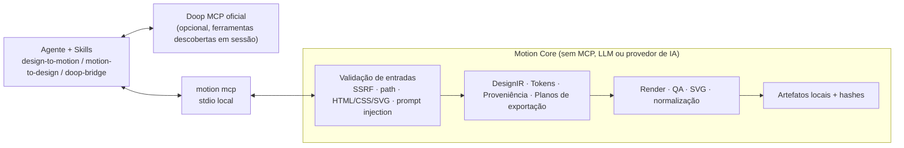

# Arquitetura Desacoplada, Evolução de Skills, Motion MCP & ADRs

> **Status:** Decisões históricas e vigentes. O diagrama e o ADR-007 refletem a arquitetura em vigor desde 2026-11-25; ADRs supersedidos permanecem somente como registro histórico.

---

## 1. Arquitetura Vigente (`stdio` local + coordenação pelo agente)

O `motion-core` não importa nem depende do Doop. Toda troca de dados passa por contratos neutros em `packages/motion-core/bridge/`:



---

## 2. ADRs Definitivos

### ADR-001 — Consolidação de Skills (`ui-motion-design` consolidada em `design-to-motion`)
- **Decisão:** Não criar a skill independente `ui-motion-design`. Consolidar suas responsabilidades dentro de `design-to-motion` com *progressive disclosure*, reutilizando `animate`, `emil-design-eng`, `explainer-motion`, `prototype` e `web-director`.
- **Critério:** Novas skills só nascem quando há responsabilidade claramente independente e sem sobreposição.

### ADR-002 — Empacotamento e Independência da Skill Global `doop-designer`
- **Decisão:**
  - `design-to-motion` e `motion-to-design`: skills oficiais e independentes de editor no catálogo `@technomanceer/motion-studio-skills` (`public-skills.json` + `skills-lock.json`).
  - `doop-bridge`: integração opcional listada em `optional-integrations.json` (sem instalar ou obrigar Doop para usuários padrão do Motion).
  - `doop-designer` (`~/.agents/skills/doop-designer/`): permanece totalmente autônoma e sem dependência circular ou obrigatória com o Motion.
  - Instalação local idempotente e versionada do Motion preservada; instalação global opcional e não destrutiva.

### ADR-003 — Independência de Editor (`MotionDesignIR@1` & `EditorAdapter`)
- **Decisão:** Doop é o primeiro `EditorAdapter` suportado, jamais uma dependência do `motion-core`. Manter apenas os contratos reais necessários (`MotionDesignIR@1`, `EditorAdapter`, `DesignTokenBundle@1`, `AssetProvenanceManifest@1`), sem abstrações especulativas e sem implementar Figma/Pencil/Paper nesta primeira frente.

### ADR-004 — Evolução Única do Servidor MCP (`packages/motion-cli/lib/mcp.mjs`) — proposta histórica supersedida
- **Decisão:** Não criar um segundo servidor MCP. Evoluir `packages/motion-cli/lib/mcp.mjs` em duas etapas ordenadas:
  1. **Primeiro:** estabilizar contratos, adapters e novas ferramentas locais sobre **`stdio`** (transporte local padrão) com registro único de ferramentas, schemas compartilhados e paridade CLI=MCP.
  2. **Depois (após estabilização):** adicionar transporte opcional **Streamable HTTP** (`--transport=http`) compartilhando exatamente o mesmo registro de ferramentas e schemas, com paridade semântica entre transportes.

### ADR-005 — Segurança, Auth OAuth 2.1 & Secure MCP Tunnel (Transporte Remoto) — proposta histórica supersedida
Baseado nas especificações oficiais (`modelcontextprotocol.io`, `developers.openai.com/plugins/build/mcp-server` e `/auth`):
- **Especificação OAuth 2.1 (MCP Authorization):**
  - Servidor MCP HTTP atua como **OAuth 2.1 Resource Server** validando tokens Bearer (`RFC 6750`), sem emitir tokens diretamente (ou acoplado a Authorization Server dedicado).
  - Suporte a **PKCE (`S256`)**, **Protected Resource Metadata (`RFC 9728`)**, **Authorization Server Metadata (`RFC 8414`)**, **Issuer Identification (`RFC 9207`, `iss` parameter)**, **Resource Indicators (`RFC 8707`, binding estrito do `resource`)** e **Dynamic Client Registration (`RFC 7591`)** quando aplicável.
- **Desenvolvimento e Validação com ChatGPT via Secure MCP Tunnel:**
  - OpenAI **Secure MCP Tunnel** (`tunnel-client`) abre conexão HTTPS exclusivamente de saída para testes privados/locais com ChatGPT sem abrir portas públicas de entrada.
  - **Limitação documentada:** Secure MCP Tunnel destina-se apenas a conexões privadas e desenvolvimento; submissão pública ao diretório global exige endpoint HTTPS público estável (`/mcp`) com Streamable HTTP e OAuth 2.1 completo.
- **Hardening do Servidor HTTP:**
  - Controle de acesso por escopo e isolamento estrito de diretório/artefatos por `userId/projectId`.
  - Limites de concorrência de fila de render (Chromium/FFmpeg), timeouts, cancelamento (`notifications/cancelled`), retenção controlada de artefatos e proteção contra execução arbitrária de comandos (zero interpolação em shell).
  - Observabilidade estruturada (`traceId`, `jobId`, duração, hashes, erros sem vazar segredos/tokens).
  - **Zero API keys de IA exigidas** pelo servidor Motion — todos os motores rodam deterministicamente.

### ADR-006 — Segurança Contra Conteúdo Importado Não Confiável
- **Decisão:** Tratar todo HTML, CSS, SVG, JSON e URL vindos de editores como entrada hostil:
  - Bloqueio de path traversal (`safeRelativePath`), SSRF (`safeRemoteUrl`), injeção de comandos e execução arbitrária de JS importado (`scanUntrustedHtml` remove `<script>`, `on*`, `javascript:`, `<foreignObject>`, `<iframe>`).
  - Detecção e isolamento de **prompt injection** em comentários, `alt`, `aria-label` e metadados de frames.
  - Preservação obrigatória de `sha256`, origem e licença (`assessLicense`) em `AssetProvenanceManifest@1`.
  - Execução de renderização apenas em processo isolado (Playwright/Chromium sandboxed e servidor estático local restrito à pasta da produção).

### ADR-007 — Motion MCP estritamente local e coordenação pelo agente (2026-11-25)
- **Decisão vigente:** o único Motion MCP é um processo local por `stdio`, configurado pelo cliente na máquina do usuário. stdout contém somente mensagens do protocolo MCP; logs e diagnósticos usam stderr.
- O registro centralizado de ferramentas é uma interface para os motores do Motion Core. Core permanece independente de MCP, SDKs de agente e provedores de IA.
- O Motion MCP não incorpora, substitui nem faz proxy do Doop MCP. O agente inspeciona as ferramentas Doop disponíveis e usa cada servidor diretamente. Ferramentas Bridge locais devolvem contratos, planos e payloads com `executed: false` quando a execução depende do Doop.
- Streamable HTTP, OAuth 2.1, Secure MCP Tunnel, hospedagem remota, multiusuário e execução remota não fazem parte do roadmap vigente. As propostas ADR-004 (fase HTTP) e ADR-005 permanecem registradas somente como histórico de decisões superadas.
- Isolamento por workspace, validação de entrada hostil, limites locais de execução/concorrência, cancelamento suportado pelo motor e hash de artefatos são aplicados independentemente do transporte local.
- M5 distribui `design-to-motion` e `motion-to-design` como Skills first-party e cataloga `doop-bridge` como integração opcional; o perfil `integration` seleciona as três sem criar dependência do Doop.
- M6 limita cada linha stdio a 20 MiB, pedidos pendentes a 64, a fila de operações a 32 e o histórico de jobs a 128. A produção local foi homologada por cliente MCP de referência e por smoke tests de clientes disponíveis; a integração Doop externa permanece pendente quando o laboratório autorizado não está presente.

---

## 3. Grafo de Skills Sem Ciclos

```text
doop-designer (autônoma em ~/.agents/skills/doop-designer/)
      ▲
      │ orquestração opcional (sem dependência circular)
doop-bridge (optional-integrations.json)
      ├──► design-to-motion (@technomanceer/motion-studio-skills)
      │        └── reutiliza animate / emil-design-eng / explainer-motion / prototype / web-director
      └──► motion-to-design (@technomanceer/motion-studio-skills)
               └── prepara stills, storyboards, tokens, SVGs e payloads `executed: false`
```
